# Laravel Eloquent Relationships — Visual Guide

[](https://laravel.com)
[](https://www.php.net)
[](LICENSE)

A practical, diagram-first reference for **every Eloquent relationship**: what it is, which tables and columns it needs, how to define it, how to access it, and when to pick it.

Open this file, scan the diagram, copy the pattern.

---

## Getting Started

**Requirements:** PHP 8.3+, Composer, SQLite (default) or any database supported by Laravel.

```bash
git clone https://github.com/<your-username>/laravel-eloquent-relationships.git
cd laravel-eloquent-relationships

composer install
cp .env.example .env
php artisan key:generate

touch database/database.sqlite
php artisan migrate:fresh --seed
```

`migrate:fresh --seed` drops every table, rebuilds the schema and fills it with demo data. The seeders expect empty tables, so always use `migrate:fresh --seed` when you want to start over.

---

## Implemented Relationships

Every relationship below has a working JSON API in this repository. Business logic lives in single-purpose **Action** classes, controllers only validate the request and return a response.

| Relationship | Official docs | Controllers | Actions | Request to try first |
|--------------|---------------|-------------|---------|----------------------|
| One To One | [Laravel docs](https://laravel.com/docs/eloquent-relationships#one-to-one) | [`UserPhoneController`](app/Http/Controllers/User/UserPhoneController.php), [`PhoneUserController`](app/Http/Controllers/Phone/PhoneUserController.php) | [`app/Actions/User`](app/Actions/User), [`app/Actions/Phone`](app/Actions/Phone) | `GET /api/one-to-one/users` |
| One To Many | [Laravel docs](https://laravel.com/docs/eloquent-relationships#one-to-many) | [`UserPostController`](app/Http/Controllers/User/UserPostController.php), [`PostUserController`](app/Http/Controllers/Post/PostUserController.php) | [`app/Actions/User`](app/Actions/User), [`app/Actions/Post`](app/Actions/Post) | `GET /api/one-to-many/users/stats` |
| Many To Many | [Laravel docs](https://laravel.com/docs/eloquent-relationships#many-to-many) | [`UserRoleController`](app/Http/Controllers/User/UserRoleController.php), [`RoleUserController`](app/Http/Controllers/Role/RoleUserController.php) | [`app/Actions/User`](app/Actions/User), [`app/Actions/Role`](app/Actions/Role) | `GET /api/many-to-many/roles` |
| Has One Through | [Laravel docs](https://laravel.com/docs/eloquent-relationships#has-one-through) | [`MechanicOwnerController`](app/Http/Controllers/Mechanic/MechanicOwnerController.php), [`CarOwnerController`](app/Http/Controllers/Car/CarOwnerController.php), [`OwnerMechanicController`](app/Http/Controllers/Owner/OwnerMechanicController.php) | [`app/Actions/Mechanic`](app/Actions/Mechanic), [`app/Actions/Car`](app/Actions/Car), [`app/Actions/Owner`](app/Actions/Owner) | `GET /api/has-one-through/mechanics` |
| Has Many Through | [Laravel docs](https://laravel.com/docs/eloquent-relationships#has-many-through) | [`CountryPostController`](app/Http/Controllers/Country/CountryPostController.php), [`PostCountryController`](app/Http/Controllers/Post/PostCountryController.php) | [`app/Actions/Country`](app/Actions/Country), [`app/Actions/Post`](app/Actions/Post) | `GET /api/has-many-through/countries/stats` |
| Polymorphic One To One | [Laravel docs](https://laravel.com/docs/eloquent-relationships#one-to-one-polymorphic-relations) | [`ImageableController`](app/Http/Controllers/Image/ImageableController.php), [`ImageController`](app/Http/Controllers/Image/ImageController.php) | [`app/Actions/Image`](app/Actions/Image) | `GET /api/polymorphic-one-to-one/images` |

The routes are in [`routes/api.php`](routes/api.php). Run `php artisan route:list --path=api` to see all of them.

### Architecture

```text
HTTP request
   │
   ▼
routes/api.php ──► Controller ──► FormRequest (validation)
                      │
                      ▼
                   Action::execute()   ← all Eloquent code and business rules
                      │
                      ▼
                   Model / relationship
                      │
                      ▼
Controller returns $this->success() / $this->created()   ← ApiResponse trait
```

| Part | Location | Responsibility |
|------|----------|----------------|
| Controller | [`app/Http/Controllers`](app/Http/Controllers) | Read input, call one action, return JSON |
| Action | [`app/Actions`](app/Actions) | One operation per class with an `execute()` method. Folders are named after models: `User`, `Phone`, `Post`, `Role`, `Mechanic`, `Car`, `Owner`, `Country`, `Image` |
| Form request | [`app/Http/Requests`](app/Http/Requests) | Validation rules |
| JSON trait | [`app/Traits/ApiResponse.php`](app/Traits/ApiResponse.php) | `success()`, `created()`, `error()`, `notFound()`, `conflict()`. Used by the base [`Controller`](app/Http/Controllers/Controller.php), so every controller returns JSON |
| Exceptions | [`app/Exceptions`](app/Exceptions) | `ResourceNotFoundException` (404) and `ResourceConflictException` (409) render themselves as JSON |
| Error handling | [`bootstrap/app.php`](bootstrap/app.php) | Unknown routes, missing models and validation errors under `/api` return the same JSON shape |

### JSON response format

Every response uses the same envelope.

```json
{
    "success": true,
    "message": "OK",
    "data": {}
}
```

```json
{
    "success": false,
    "message": "The given data was invalid.",
    "errors": { "number": ["The number field format is invalid."] }
}
```

### Try it

```bash
php artisan migrate:fresh --seed
php artisan serve
```

```bash
# One To One: the phone of user 1
curl http://127.0.0.1:8000/api/one-to-one/users/1/phone

# One To Many: users with posts_count, posts_exists and posts_max_created_at
curl http://127.0.0.1:8000/api/one-to-many/users/stats

# Many To Many: attach a role with a pivot value
curl -X POST http://127.0.0.1:8000/api/many-to-many/users/8/roles \
  -H "Accept: application/json" -H "Content-Type: application/json" \
  -d '{"role_id": 4, "expires_at": "2027-01-01"}'
```

---

## Database Schema

One schema covers every Eloquent relationship type. Each table exists to demonstrate at least one relationship, and the seeders add data with edge cases (a user without a phone, a post without an author, a car without an owner) so you can see how each relationship behaves when something is missing.

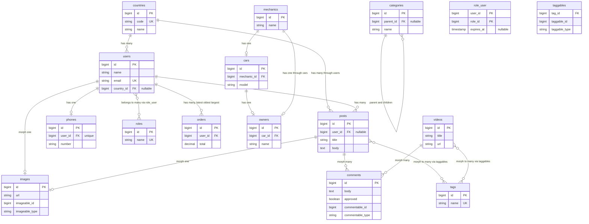

### Relationship to table map

| Relationship | Tables | Eloquent methods | Seeder |
|--------------|--------|------------------|--------|
| One To One | `users` → `phones` | `User::phone()`, `Phone::user()` | `PhoneSeeder` |
| One To Many | `users` → `posts` | `User::posts()`, `Post::user()` | `PostSeeder` |
| Many To Many | `users` ↔ `roles` via `role_user` | `User::roles()`, `Role::users()` | `RoleSeeder` |
| Has One Through | `mechanics` → `cars` → `owners` | `Mechanic::owner()` | `MechanicSeeder` |
| Has Many Through | `countries` → `users` → `posts` | `Country::posts()` | `CountrySeeder`, `UserSeeder`, `PostSeeder` |
| One Of Many | `users` → `orders` | `User::latestOrder()`, `oldestOrder()`, `largestOrder()` | `OrderSeeder` |
| Polymorphic One To One | `images` ← `users`, `posts` | `User::image()`, `Post::image()`, `Image::imageable()` | `ImageSeeder` |
| Polymorphic One To Many | `comments` ← `posts`, `videos` | `Post::comments()`, `Video::comments()`, `Comment::commentable()` | `CommentSeeder` |
| Polymorphic Many To Many | `tags` ↔ `posts`, `videos` via `taggables` | `Post::tags()`, `Tag::posts()`, `Tag::videos()` | `TagSeeder` |
| Self Referencing | `categories` → `categories` | `Category::parent()`, `children()`, `descendants()` | `CategorySeeder` |
| Default Model | `posts` → `users` | `Post::author()` | `PostSeeder` |

### Seeded data cheat sheet

Use these numbers to check that a relationship returns what you expect. Users are created in this order: Talha (1), Rafi (2), Nusrat (3), Sami (4), John (5), Anna (6), Yuki (7), Guest (8).

| Topic | What is seeded |
|-------|----------------|
| Countries | `BD` (Talha, Rafi, Nusrat), `US` (Sami, John), `DE` (Anna), `JP` (Yuki). Guest has `country_id = NULL` |
| Has Many Through | Posts reached through country: `BD` 9, `US` 3, `DE` 2, `JP` 1 |
| One To One | 6 phones. Yuki and Guest have none |
| One To Many | 16 posts. Talha 4, Rafi 3, Nusrat 2, Sami 2, John 1, Anna 2, Yuki 1, Guest 0, plus `Anonymous Announcement` with `user_id = NULL` |
| Many To Many | 4 roles, 9 `role_user` rows. Sami's `subscriber` expired 10 days ago, Rafi's `author` expires in 30 days, Yuki's `subscriber` in 7 days |
| Has One Through | Karim → Abdul Hamid, Rahim → Selina Akter, Jamal has a car but no owner, Salam has no car |
| One Of Many | Talha: latest `45.00` (1 day ago), oldest `120.50` (17 days ago), largest `980.00`. Rafi 2 orders, Nusrat 1 order |
| Polymorphic One To One | Images for users 1 to 3 and posts 1 to 3. One image per model, enforced by a unique index |
| Polymorphic One To Many | 12 comments: the first 4 posts get 2 each (1 not approved), each of the 4 videos gets 1 |
| Polymorphic Many To Many | 5 tags. Every post has 2 tags, every video has 1 tag (36 `taggables` rows) |
| Self Referencing | 10 categories in 3 levels. Roots: `Electronics` and `Books` |

---

## Table of Contents

- [Getting Started](#getting-started)
- [Implemented Relationships](#implemented-relationships)
- [Database Schema](#database-schema)

1. [Quick Reference](#1-quick-reference)
2. [Which Relationship Do I Need?](#2-which-relationship-do-i-need)
3. [Naming Conventions](#3-naming-conventions)
4. [One To One — `hasOne` / `belongsTo`](#4-one-to-one--hasone--belongsto)
5. [One To Many — `hasMany` / `belongsTo`](#5-one-to-many--hasmany--belongsto)
6. [Many To Many — `belongsToMany`](#6-many-to-many--belongstomany)
7. [Has One Through — `hasOneThrough`](#7-has-one-through--hasonethrough)
8. [Has Many Through — `hasManyThrough`](#8-has-many-through--hasmanythrough)
9. [One Of Many — `latestOfMany` / `oldestOfMany` / `ofMany`](#9-one-of-many--latestofmany--oldestofmany--ofmany)
10. [Polymorphic One To One — `morphOne` / `morphTo`](#10-polymorphic-one-to-one--morphone--morphto)
11. [Polymorphic One To Many — `morphMany` / `morphTo`](#11-polymorphic-one-to-many--morphmany--morphto)
12. [Polymorphic Many To Many — `morphToMany` / `morphedByMany`](#12-polymorphic-many-to-many--morphtomany--morphedbymany)
13. [Self-Referencing Relationships](#13-self-referencing-relationships)
14. [Default Models — `withDefault`](#14-default-models--withdefault)
15. [Accessing Relationships](#15-accessing-relationships)
16. [Writing Through Relationships](#16-writing-through-relationships)
17. [Querying Relationships](#17-querying-relationships)
18. [Eager Loading and the N+1 Problem](#18-eager-loading-and-the-n1-problem)
19. [Best Practices](#19-best-practices)
20. [Common Mistakes](#20-common-mistakes)
21. [License](#21-license)

---

## 1. Quick Reference

| # | Relationship | Cardinality | Foreign key lives on | Defined on | Inverse |
|---|--------------|-------------|----------------------|------------|---------|
| 1 | `hasOne` | 1 → 1 | Related table | Parent | `belongsTo` |
| 2 | `hasMany` | 1 → N | Related table | Parent | `belongsTo` |
| 3 | `belongsTo` | N → 1 | **This** table | Child | `hasOne` / `hasMany` |
| 4 | `belongsToMany` | N ↔ N | Pivot table | Both sides | `belongsToMany` |
| 5 | `hasOneThrough` | 1 → 1 via intermediate | Intermediate and related tables | Parent | — |
| 6 | `hasManyThrough` | 1 → N via intermediate | Intermediate and related tables | Parent | — |
| 7 | `latestOfMany` / `oldestOfMany` / `ofMany` | 1 → 1 (picked from many) | Related table | Parent | `belongsTo` |
| 8 | `morphOne` | 1 → 1, many model types | Related table (`*_id` + `*_type`) | Parent | `morphTo` |
| 9 | `morphMany` | 1 → N, many model types | Related table (`*_id` + `*_type`) | Parent | `morphTo` |
| 10 | `morphTo` | N → 1, any model type | **This** table (`*_id` + `*_type`) | Child | `morphOne` / `morphMany` |
| 11 | `morphToMany` | N ↔ N, polymorphic | Pivot table (`*_id` + `*_type`) | Owner | `morphedByMany` |
| 12 | `morphedByMany` | N ↔ N, polymorphic | Pivot table (`*_id` + `*_type`) | Target | `morphToMany` |

> **Rule of thumb:** the model whose table holds the foreign key calls `belongsTo`. The other side calls `hasOne` or `hasMany`.

---

## 2. Which Relationship Do I Need?

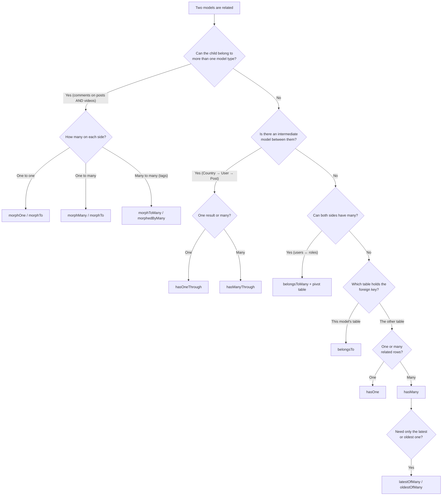

---

## 3. Naming Conventions

Eloquent guesses table names, key names, and pivot names. Follow the conventions and you write almost no configuration.

| Thing | Convention | Example |
|-------|-----------|---------|
| Model | Singular `StudlyCase` | `BlogPost` |
| Table | Plural `snake_case` | `blog_posts` |
| Primary key | `id` | `blog_posts.id` |
| Foreign key | `{singular_table}_id` | `blog_post_id` |
| Pivot table | Two singular names, alphabetical, `snake_case` | `post_tag`, `role_user` |
| Morph columns | `{name}able_id` + `{name}able_type` | `commentable_id`, `commentable_type` |
| `hasOne` / `belongsTo` method | Singular | `phone()`, `user()` |
| `hasMany` / `belongsToMany` method | Plural | `comments()`, `roles()` |

Override only when you must:

```php
$this->hasMany(Comment::class, 'author_id', 'uuid'); // (related, foreignKey, localKey)
$this->belongsTo(User::class, 'author_id', 'uuid'); // (related, foreignKey, ownerKey)
```

---

## 4. One To One — `hasOne` / `belongsTo`

**Use when:** one row has exactly one related row. Example: a user has one phone.

Official docs: [One To One](https://laravel.com/docs/eloquent-relationships#one-to-one)

### Table diagram

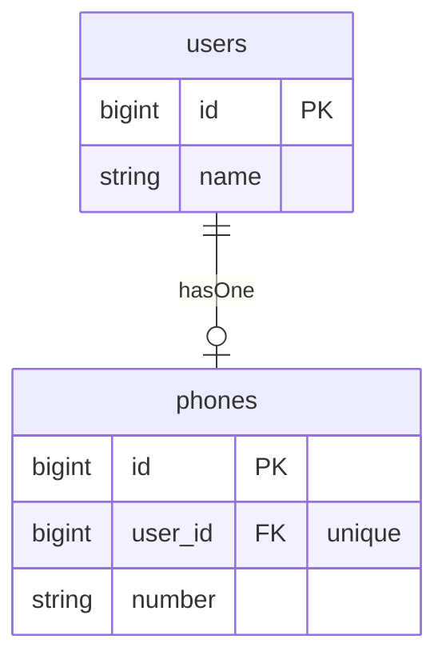

### Sample data

| users.id | users.name |
|----------|-----------|
| 1 | Talha |

| phones.id | phones.user_id | phones.number |
|-----------|----------------|---------------|
| 1 | 1 | 01700000000 |

### Migration

```php
Schema::create('phones', function (Blueprint $table) {
    $table->id();
    $table->foreignId('user_id')->unique()->constrained()->cascadeOnDelete();
    $table->string('number');
    $table->timestamps();
});
```

### Models

```php
class User extends Model
{
    /**
     * Get the phone associated with the user.
     */
    public function phone(): HasOne
    {
        return $this->hasOne(Phone::class);
    }
}

class Phone extends Model
{
    /**
     * Get the user that owns the phone.
     */
    public function user(): BelongsTo
    {
        return $this->belongsTo(User::class);
    }
}
```

### Access

```php
$user->phone;         // Phone|null
$user->phone->number; // string
$phone->user->name;   // string
```


### Implemented in this repository

- Official docs: [One To One](https://laravel.com/docs/eloquent-relationships#one-to-one)
- Controllers: [`UserPhoneController`](app/Http/Controllers/User/UserPhoneController.php) and [`PhoneUserController`](app/Http/Controllers/Phone/PhoneUserController.php)
- Actions: [`app/Actions/User`](app/Actions/User), [`app/Actions/Phone`](app/Actions/Phone)
- Seeder: [`PhoneSeeder`](database/seeders/PhoneSeeder.php)
- Base URL: `/api/one-to-one`

**Parent side: `User::phone()` (`hasOne`)**

| Method | URL | Action | Eloquent |
|--------|-----|--------|----------|
| `GET` | `/users?has_phone=1` | [`ListUsersWithPhone`](app/Actions/User/ListUsersWithPhone.php) | `with()`, `has()`, `doesntHave()` |
| `GET` | `/users/search?number=` | [`SearchUsersByPhoneNumber`](app/Actions/User/SearchUsersByPhoneNumber.php) | `withWhereHas()` |
| `GET` | `/users/{user}/phone` | [`ShowUserPhone`](app/Actions/User/ShowUserPhone.php) | `$user->phone` |
| `GET` | `/users/{user}/phone/exists` | [`CheckUserHasPhone`](app/Actions/User/CheckUserHasPhone.php) | `exists()` |
| `POST` | `/users/{user}/phone/create` | [`CreateUserPhone`](app/Actions/User/CreateUserPhone.php) | `create()` |
| `POST` | `/users/{user}/phone/save` | [`SaveUserPhone`](app/Actions/User/SaveUserPhone.php) | `save()` |
| `POST` | `/users/{user}/phone/first-or-create` | [`FirstOrCreateUserPhone`](app/Actions/User/FirstOrCreateUserPhone.php) | `firstOrCreate()` |
| `PUT` | `/users/{user}/phone` | [`UpdateOrCreateUserPhone`](app/Actions/User/UpdateOrCreateUserPhone.php) | `updateOrCreate()` |
| `PATCH` | `/users/{user}/phone` | [`UpdateUserPhone`](app/Actions/User/UpdateUserPhone.php) | `phone()->update()` |
| `DELETE` | `/users/{user}/phone` | [`DeleteUserPhone`](app/Actions/User/DeleteUserPhone.php) | `phone()->delete()` |

**Reverse side: `Phone::user()` (`belongsTo`)**

| Method | URL | Action | Eloquent |
|--------|-----|--------|----------|
| `GET` | `/phones?name=` | [`ListPhonesWithUser`](app/Actions/Phone/ListPhonesWithUser.php) | `with()`, `whereRelation()` |
| `GET` | `/phones/by-user/{user}` | [`FindPhoneByUser`](app/Actions/Phone/FindPhoneByUser.php) | `whereBelongsTo()` |
| `GET` | `/phones/{phone}/user` | [`ShowPhoneOwner`](app/Actions/Phone/ShowPhoneOwner.php) | `$phone->user` |
| `GET` | `/phones/{phone}/owner/{user}` | [`CheckPhoneOwner`](app/Actions/Phone/CheckPhoneOwner.php) | `is()` |
| `PUT` | `/phones/{phone}/user` | [`ReassignPhoneOwner`](app/Actions/Phone/ReassignPhoneOwner.php) | `associate()` |
| `PATCH` | `/phones/{phone}/user` | [`UpdatePhoneOwner`](app/Actions/Phone/UpdatePhoneOwner.php) | `user()->update()` |
| `DELETE` | `/phones/{phone}` | [`DeletePhone`](app/Actions/Phone/DeletePhone.php) | `delete()` |
| `DELETE` | `/phones/{phone}/user` | [`DeletePhoneOwner`](app/Actions/Phone/DeletePhoneOwner.php) | `user()->delete()`, the foreign key cascade removes the phone |

`dissociate()` is not available here because `phones.user_id` is `NOT NULL`. See the [One To Many](#5-one-to-many--hasmany--belongsto) section for `dissociate()` on a nullable foreign key.

---

## 5. One To Many — `hasMany` / `belongsTo`

**Use when:** one parent has many children. Example: a user writes many posts.

Official docs: [One To Many](https://laravel.com/docs/eloquent-relationships#one-to-many)

### Table diagram

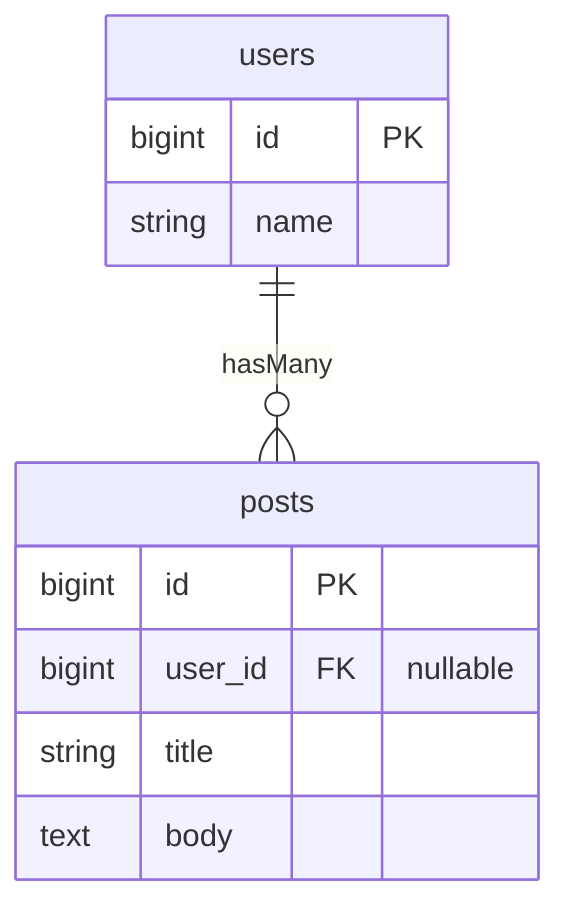

### Sample data

| users.id | users.name |
|----------|-----------|
| 1 | Talha Faisal |

| posts.id | posts.user_id | posts.title |
|----------|---------------|-------------|
| 1 | 1 | Hello World |
| 2 | 1 | Laravel Tips |
| 3 | NULL | Anonymous Announcement |

### Migration

```php
Schema::create('posts', function (Blueprint $table): void {
    $table->id();
    $table->foreignId('user_id')->nullable()->constrained()->nullOnDelete();
    $table->string('title');
    $table->text('body');
    $table->timestamps();
});
```

### Models

```php
class User extends Authenticatable
{
    /**
     * Get the posts written by the user.
     */
    public function posts(): HasMany
    {
        return $this->hasMany(Post::class);
    }
}

class Post extends Model
{
    /**
     * Get the user that wrote the post.
     */
    public function user(): BelongsTo
    {
        return $this->belongsTo(User::class);
    }

    /**
     * Get the author of the post, or a guest author when there is none.
     */
    public function author(): BelongsTo
    {
        return $this->belongsTo(User::class, 'user_id')->withDefault([
            'name' => 'Guest Author',
        ]);
    }
}
```

### Access

```php
$user->posts;                           // Collection<Post>
$user->posts()->count();                // runs a COUNT query
$user->posts()->where('title', 'like', '%Laravel%')->get();
$post->user->name;                      // string, or null when user_id is NULL
$post->author->name;                    // "Guest Author" when user_id is NULL
```

> `$user->posts` loads the relation into memory. `$user->posts()` returns the query builder so you can add constraints.


### Implemented in this repository

- Official docs: [One To Many](https://laravel.com/docs/eloquent-relationships#one-to-many)
- Controllers: [`UserPostController`](app/Http/Controllers/User/UserPostController.php) and [`PostUserController`](app/Http/Controllers/Post/PostUserController.php)
- Actions: [`app/Actions/User`](app/Actions/User), [`app/Actions/Post`](app/Actions/Post)
- Seeder: [`PostSeeder`](database/seeders/PostSeeder.php)
- Base URL: `/api/one-to-many`

**Parent side: `User::posts()` (`hasMany`)**

| Method | URL | Action | Eloquent |
|--------|-----|--------|----------|
| `GET` | `/users?has_posts=1&min=2` | [`ListUsersWithPosts`](app/Actions/User/ListUsersWithPosts.php) | `with()`, `has()`, `doesntHave()` |
| `GET` | `/users/stats` | [`GetUserPostStats`](app/Actions/User/GetUserPostStats.php) | `withCount()`, `withExists()`, `withMax()` |
| `GET` | `/users/search?title=` | [`SearchUsersByPostTitle`](app/Actions/User/SearchUsersByPostTitle.php) | `withWhereHas()` |
| `GET` | `/users/{user}/posts` | [`ShowUserPosts`](app/Actions/User/ShowUserPosts.php) | `$user->posts` |
| `GET` | `/users/{user}/posts/count` | [`CountUserPosts`](app/Actions/User/CountUserPosts.php) | `count()`, `exists()` |
| `GET` | `/users/{user}/posts/latest` | [`FindLatestUserPost`](app/Actions/User/FindLatestUserPost.php) | `latest()->first()` |
| `GET` | `/users/{user}/posts/filter?title=` | [`FilterUserPosts`](app/Actions/User/FilterUserPosts.php) | `posts()->where()` |
| `GET` | `/users/{user}/posts/{post}` | [`FindUserPost`](app/Actions/User/FindUserPost.php) | `posts()->findOrFail()` |
| `GET` | `/users/{user}/posts/summary` | [`GetUserPostSummary`](app/Actions/User/GetUserPostSummary.php) | `loadCount()`, `load()` |
| `POST` | `/users/{user}/posts/create` | [`CreateUserPost`](app/Actions/User/CreateUserPost.php) | `create()` |
| `POST` | `/users/{user}/posts/create-many` | [`CreateUserPosts`](app/Actions/User/CreateUserPosts.php) | `createMany()` |
| `POST` | `/users/{user}/posts/save` | [`SaveUserPost`](app/Actions/User/SaveUserPost.php) | `save()` |
| `POST` | `/users/{user}/posts/save-many` | [`SaveUserPosts`](app/Actions/User/SaveUserPosts.php) | `saveMany()` |
| `POST` | `/users/{user}/posts/first-or-create` | [`FirstOrCreateUserPost`](app/Actions/User/FirstOrCreateUserPost.php) | `firstOrCreate()` |
| `PUT` | `/users/{user}/posts/update-or-create` | [`UpdateOrCreateUserPost`](app/Actions/User/UpdateOrCreateUserPost.php) | `updateOrCreate()` |
| `POST` | `/users/{user}/posts/{post}/adopt` | [`AdoptPost`](app/Actions/User/AdoptPost.php) | `save()` on an existing post |
| `PATCH` | `/users/{user}/posts` | [`UpdateUserPosts`](app/Actions/User/UpdateUserPosts.php) | `posts()->update()` |
| `PATCH` | `/users/{user}/posts/{post}` | [`UpdateUserPost`](app/Actions/User/UpdateUserPost.php) | `findOrFail()`, `update()` |
| `DELETE` | `/users/{user}/posts/{post}` | [`DeleteUserPost`](app/Actions/User/DeleteUserPost.php) | `findOrFail()`, `delete()` |
| `DELETE` | `/users/{user}/posts` | [`DeleteUserPosts`](app/Actions/User/DeleteUserPosts.php) | `posts()->delete()` |

**Reverse side: `Post::user()` and `Post::author()` (`belongsTo`)**

| Method | URL | Action | Eloquent |
|--------|-----|--------|----------|
| `GET` | `/posts?default=1` | [`ListPostsWithAuthor`](app/Actions/Post/ListPostsWithAuthor.php) | `with('user')`, `with('author')` default model |
| `GET` | `/posts/orphans` | [`ListOrphanPosts`](app/Actions/Post/ListOrphanPosts.php) | `doesntHave()` |
| `GET` | `/posts/search?name=` | [`SearchPostsByAuthorName`](app/Actions/Post/SearchPostsByAuthorName.php) | `whereRelation()` |
| `GET` | `/posts/by-user/{user}` | [`ListPostsByUser`](app/Actions/Post/ListPostsByUser.php) | `whereBelongsTo()` |
| `GET` | `/posts/{post}/user?default=1` | [`ShowPostAuthor`](app/Actions/Post/ShowPostAuthor.php) | `$post->user`, `$post->author` |
| `GET` | `/posts/{post}/author/{user}` | [`CheckPostAuthor`](app/Actions/Post/CheckPostAuthor.php) | `is()` |
| `PUT` | `/posts/{post}/user` | [`ReassignPostAuthor`](app/Actions/Post/ReassignPostAuthor.php) | `associate()` |
| `DELETE` | `/posts/{post}/user` | [`RemovePostAuthor`](app/Actions/Post/RemovePostAuthor.php) | `dissociate()` |
| `PATCH` | `/posts/{post}/user` | [`UpdatePostAuthor`](app/Actions/Post/UpdatePostAuthor.php) | `user()->update()` |
| `DELETE` | `/posts/{post}` | [`DeletePost`](app/Actions/Post/DeletePost.php) | `delete()` |
| `DELETE` | `/posts/{post}/user/destroy` | [`DeletePostAuthor`](app/Actions/Post/DeletePostAuthor.php) | `user()->delete()`, `nullOnDelete` sets `user_id` to null |

`Post::author()` is the same relationship as `Post::user()` with `withDefault()`, so a post without an author returns an unsaved `Guest Author` user instead of `null`.

---

## 6. Many To Many — `belongsToMany`

**Use when:** both sides can have many. Example: users have many roles, roles have many users.

Official docs: [Many To Many](https://laravel.com/docs/eloquent-relationships#many-to-many)

### Table diagram

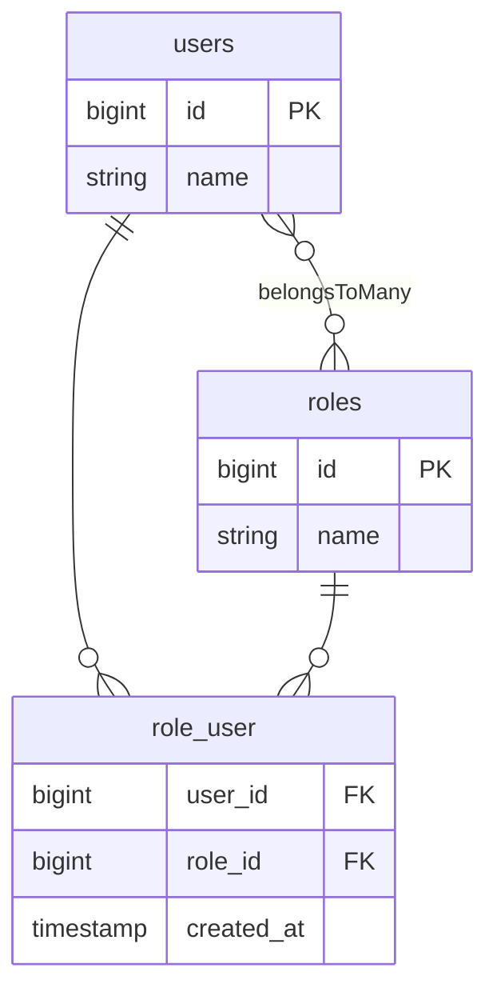

### Sample data

| users.id | name |
|----------|------|
| 1 | Talha |
| 2 | Rafi |

| roles.id | name |
|----------|------|
| 1 | admin |
| 2 | editor |

| role_user.user_id | role_user.role_id |
|-------------------|-------------------|
| 1 | 1 |
| 1 | 2 |
| 2 | 2 |

### Migration

```php
Schema::create('role_user', function (Blueprint $table) {
    $table->foreignId('user_id')->constrained()->cascadeOnDelete();
    $table->foreignId('role_id')->constrained()->cascadeOnDelete();
    $table->timestamps();
    $table->primary(['user_id', 'role_id']);
});
```

### Models

```php
class User extends Model
{
    /**
     * The roles that belong to the user.
     */
    public function roles(): BelongsToMany
    {
        return $this->belongsToMany(Role::class)->withTimestamps();
    }
}

class Role extends Model
{
    /**
     * The users that belong to the role.
     */
    public function users(): BelongsToMany
    {
        return $this->belongsToMany(User::class)->withTimestamps();
    }
}
```

### Access

```php
$user->roles;                    // Collection<Role>
$user->roles->pluck('name');     // ['admin', 'editor']
$user->roles()->where('name', 'admin')->exists();
$role->pivot->created_at;        // pivot columns via ->pivot
```

### Pivot operations

| Method | Effect |
|--------|--------|
| `attach($id)` | Add a row to the pivot table |
| `attach($id, ['expires_at' => $date])` | Add a row with extra pivot data |
| `detach($id)` | Remove one row (no argument removes all) |
| `sync([1, 2, 3])` | Make the pivot match exactly this list |
| `syncWithoutDetaching([1, 2])` | Add missing ids, never remove |
| `toggle([1, 2])` | Attach missing ids, detach existing ones |
| `updateExistingPivot($id, [...])` | Update extra columns on an existing row |

### Extra pivot columns

```php
/**
 * The roles that belong to the user.
 */
public function roles(): BelongsToMany
{
    return $this->belongsToMany(Role::class)
        ->withPivot('expires_at')
        ->withTimestamps();
}

$user->roles->first()->pivot->expires_at;
```

### Custom pivot model

Use a model when the pivot has its own logic or casts.

```php
/**
 * The roles that belong to the user.
 */
public function roles(): BelongsToMany
{
    return $this->belongsToMany(Role::class)->using(RoleUser::class);
}

class RoleUser extends Pivot
{
    protected $casts = [
        'expires_at' => 'datetime',
    ];
}
```


### Implemented in this repository

- Official docs: [Many To Many](https://laravel.com/docs/eloquent-relationships#many-to-many)
- Controllers: [`UserRoleController`](app/Http/Controllers/User/UserRoleController.php) and [`RoleUserController`](app/Http/Controllers/Role/RoleUserController.php)
- Actions: [`app/Actions/User`](app/Actions/User), [`app/Actions/Role`](app/Actions/Role)
- Seeder: [`RoleSeeder`](database/seeders/RoleSeeder.php)
- Base URL: `/api/many-to-many`

**User side: `User::roles()` (`belongsToMany`)**

| Method | URL | Action | Eloquent |
|--------|-----|--------|----------|
| `GET` | `/users?role=admin&has_roles=0` | [`ListUsersWithRoles`](app/Actions/User/ListUsersWithRoles.php) | `with()`, `withCount()`, `whereHas()`, `doesntHave()` |
| `GET` | `/users/{user}/roles` | [`ShowUserRoles`](app/Actions/User/ShowUserRoles.php) | `$user->roles`, columns in `pivot` |
| `GET` | `/users/{user}/roles/by-pivot?status=expired` | [`ListUserRolesByPivot`](app/Actions/User/ListUserRolesByPivot.php) | `wherePivot()`, `wherePivotNull()`, `wherePivotNotNull()` |
| `GET` | `/users/{user}/roles/has?name=admin` | [`CheckUserHasRole`](app/Actions/User/CheckUserHasRole.php) | `roles()->where()->exists()` |
| `POST` | `/users/{user}/roles` | [`AttachRoleToUser`](app/Actions/User/AttachRoleToUser.php) | `attach()` with pivot data |
| `DELETE` | `/users/{user}/roles/{role}` | [`DetachRoleFromUser`](app/Actions/User/DetachRoleFromUser.php) | `detach($id)` |
| `DELETE` | `/users/{user}/roles` | [`DetachRoleFromUser`](app/Actions/User/DetachRoleFromUser.php) | `detach()` without an id removes all |
| `PUT` | `/users/{user}/roles/sync` | [`SyncUserRoles`](app/Actions/User/SyncUserRoles.php) | `sync()` |
| `PUT` | `/users/{user}/roles/sync-without-detaching` | [`SyncUserRolesWithoutDetaching`](app/Actions/User/SyncUserRolesWithoutDetaching.php) | `syncWithoutDetaching()` |
| `POST` | `/users/{user}/roles/toggle` | [`ToggleUserRoles`](app/Actions/User/ToggleUserRoles.php) | `toggle()` |
| `PATCH` | `/users/{user}/roles/{role}/pivot` | [`UpdateUserRolePivot`](app/Actions/User/UpdateUserRolePivot.php) | `updateExistingPivot()` |

**Role side: `Role::users()` (`belongsToMany`)**

| Method | URL | Action | Eloquent |
|--------|-----|--------|----------|
| `GET` | `/roles?has_users=0` | [`ListRolesWithUsers`](app/Actions/Role/ListRolesWithUsers.php) | `with()`, `withCount()`, `has()`, `doesntHave()` |
| `GET` | `/roles/{role}/users` | [`ShowRoleUsers`](app/Actions/Role/ShowRoleUsers.php) | `$role->users`, columns in `pivot` |
| `POST` | `/roles/{role}/users` | [`AttachUserToRole`](app/Actions/Role/AttachUserToRole.php) | `attach()` from the role side |
| `DELETE` | `/roles/{role}/users/{user}` | [`DetachUserFromRole`](app/Actions/Role/DetachUserFromRole.php) | `detach($id)` |
| `DELETE` | `/roles/{role}/users` | [`DetachUserFromRole`](app/Actions/Role/DetachUserFromRole.php) | `detach()` without an id removes all |
| `PUT` | `/roles/{role}/users/sync` | [`SyncRoleUsers`](app/Actions/Role/SyncRoleUsers.php) | `sync()` |

The pivot table is `role_user`. The extra column `expires_at` is exposed with `withPivot('expires_at')` and the timestamps with `withTimestamps()`. Sync payloads look like `{"roles": [{"role_id": 1, "expires_at": null}, {"role_id": 2, "expires_at": "2027-01-01"}]}`.

---

## 7. Has One Through — `hasOneThrough`

**Use when:** the parent reaches **one** distant model through an intermediate model. Example: a mechanic has one car owner, through the car.

### Table diagram

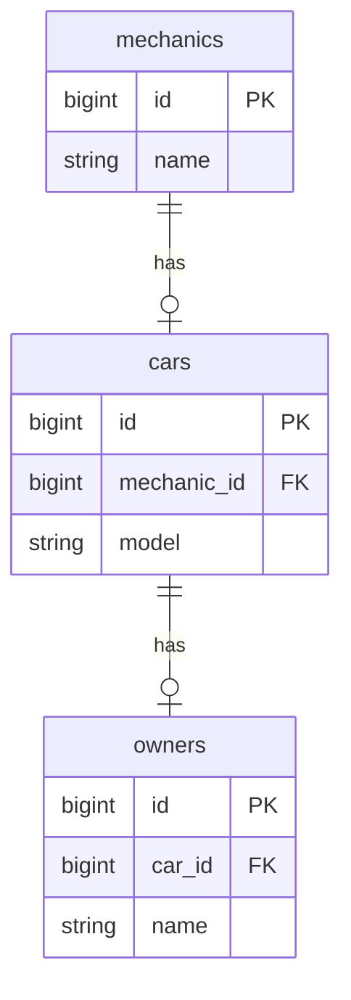

### Model

```php
class Mechanic extends Model
{
    /**
     * Get the car's owner.
     */
    public function owner(): HasOneThrough
    {
        return $this->hasOneThrough(Owner::class, Car::class);
    }
}
```

### Access

```php
$mechanic->owner; // Owner|null
```

Arguments in order: `(final model, intermediate model, FK on intermediate, FK on final, local key, intermediate local key)`.

### Implemented in this repository

- Official docs: [Has One Through](https://laravel.com/docs/eloquent-relationships#has-one-through)
- Controllers: [`MechanicOwnerController`](app/Http/Controllers/Mechanic/MechanicOwnerController.php), [`CarOwnerController`](app/Http/Controllers/Car/CarOwnerController.php) and [`OwnerMechanicController`](app/Http/Controllers/Owner/OwnerMechanicController.php)
- Actions: [`app/Actions/Mechanic`](app/Actions/Mechanic), [`app/Actions/Car`](app/Actions/Car), [`app/Actions/Owner`](app/Actions/Owner)
- Seeder: [`MechanicSeeder`](database/seeders/MechanicSeeder.php)
- Base URL: `/api/has-one-through`

**Mechanic side: `Mechanic::owner()` (`hasOneThrough`)**

| Method | URL | Action | Eloquent |
|--------|-----|--------|----------|
| `GET` | `/mechanics?has_owner=0` | [`ListMechanicsWithOwner`](app/Actions/Mechanic/ListMechanicsWithOwner.php) | `with()`, `has()`, `doesntHave()` |
| `GET` | `/mechanics/search?name=Abdul` | [`SearchMechanicsByOwnerName`](app/Actions/Mechanic/SearchMechanicsByOwnerName.php) | `withWhereHas()` |
| `GET` | `/mechanics/{mechanic}/owner` | [`ShowMechanicOwner`](app/Actions/Mechanic/ShowMechanicOwner.php) | `$mechanic->owner` |
| `GET` | `/mechanics/{mechanic}/owner/fluent` | [`ShowMechanicOwnerFluently`](app/Actions/Mechanic/ShowMechanicOwnerFluently.php) | `through('car')->has('owner')` |
| `GET` | `/mechanics/{mechanic}/owner/exists` | [`CheckMechanicHasOwner`](app/Actions/Mechanic/CheckMechanicHasOwner.php) | `owner()->exists()` |
| `PATCH` | `/mechanics/{mechanic}/owner` | [`UpdateMechanicOwner`](app/Actions/Mechanic/UpdateMechanicOwner.php) | fetch the owner, then `update()` |
| `DELETE` | `/mechanics/{mechanic}/owner` | [`DeleteMechanicOwner`](app/Actions/Mechanic/DeleteMechanicOwner.php) | fetch the owner, then `delete()` |
| `GET` | `/mechanics/{mechanic}/car` | [`ShowMechanicCar`](app/Actions/Mechanic/ShowMechanicCar.php) | `$mechanic->car` |
| `POST` | `/mechanics/{mechanic}/car` | [`CreateMechanicCar`](app/Actions/Mechanic/CreateMechanicCar.php) | `car()->create()` |

**Intermediate side: `Car::owner()` (`hasOne`)**

| Method | URL | Action | Eloquent |
|--------|-----|--------|----------|
| `POST` | `/cars/{car}/owner` | [`CreateCarOwner`](app/Actions/Car/CreateCarOwner.php) | `owner()->create()` |

**Owner side: no inverse through method, walk back with `car.mechanic`**

| Method | URL | Action | Eloquent |
|--------|-----|--------|----------|
| `GET` | `/owners` | [`ListOwnersWithMechanic`](app/Actions/Owner/ListOwnersWithMechanic.php) | `with('car.mechanic')` |
| `GET` | `/owners/by-mechanic/{mechanic}` | [`ListOwnersByMechanic`](app/Actions/Owner/ListOwnersByMechanic.php) | `whereHas()`, `whereBelongsTo()` |
| `GET` | `/owners/{owner}/mechanic` | [`ShowOwnerMechanic`](app/Actions/Owner/ShowOwnerMechanic.php) | `$owner->car?->mechanic` |

A through relationship is read only. There is no `create()` or `attach()` on it, so you write to the intermediate model (`car`) or to the final model (`owner`) directly. Seed data: Karim → Abdul Hamid, Rahim → Selina Akter, Jamal has a car without an owner, Salam has no car.

---

## 8. Has Many Through — `hasManyThrough`

**Use when:** the parent reaches **many** distant models through an intermediate model. Example: a country has many posts, through its users.

### Table diagram

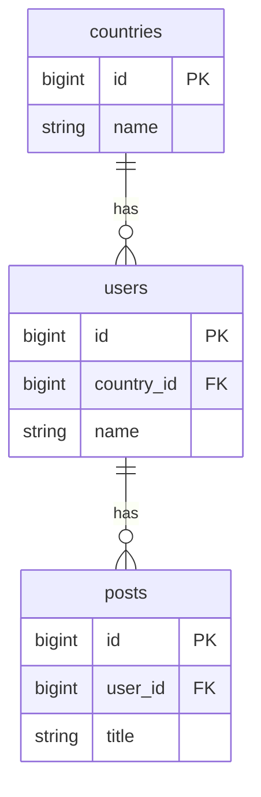

### Model

```php
class Country extends Model
{
    /**
     * Get all posts written by users of the country.
     */
    public function posts(): HasManyThrough
    {
        return $this->hasManyThrough(Post::class, User::class);
    }
}
```

### Access

```php
$country->posts;                 // Collection<Post>
$country->posts()->latest()->take(5)->get();
```

> There is no `posts.country_id`. Eloquent joins `countries → users → posts` for you.

### Implemented in this repository

- Official docs: [Has Many Through](https://laravel.com/docs/eloquent-relationships#has-many-through)
- Controllers: [`CountryPostController`](app/Http/Controllers/Country/CountryPostController.php) and [`PostCountryController`](app/Http/Controllers/Post/PostCountryController.php)
- Actions: [`app/Actions/Country`](app/Actions/Country), [`app/Actions/Post`](app/Actions/Post)
- Seeders: [`CountrySeeder`](database/seeders/CountrySeeder.php), [`UserSeeder`](database/seeders/UserSeeder.php), [`PostSeeder`](database/seeders/PostSeeder.php)
- Base URL: `/api/has-many-through`

**Country side: `Country::posts()` (`hasManyThrough`)**

| Method | URL | Action | Eloquent |
|--------|-----|--------|----------|
| `GET` | `/countries?has_posts=1&min=2` | [`ListCountriesWithPosts`](app/Actions/Country/ListCountriesWithPosts.php) | `withCount()`, `has('posts', '>=', n)`, `doesntHave()` |
| `GET` | `/countries/stats` | [`GetCountryPostStats`](app/Actions/Country/GetCountryPostStats.php) | `withCount(['users', 'posts'])` |
| `GET` | `/countries/search?title=Laravel` | [`SearchCountriesByPostTitle`](app/Actions/Country/SearchCountriesByPostTitle.php) | `withWhereHas()` |
| `GET` | `/countries/{country}/posts` | [`ShowCountryPosts`](app/Actions/Country/ShowCountryPosts.php) | `$country->posts` |
| `GET` | `/countries/{country}/posts/count` | [`CountCountryPosts`](app/Actions/Country/CountCountryPosts.php) | `posts()->count()` |
| `GET` | `/countries/{country}/posts/latest` | [`FindLatestCountryPost`](app/Actions/Country/FindLatestCountryPost.php) | `posts()->latest('posts.created_at')` |
| `GET` | `/countries/{country}/posts/filter?title=a` | [`FilterCountryPosts`](app/Actions/Country/FilterCountryPosts.php) | `posts()->where('posts.title', ...)` |
| `GET` | `/countries/{country}/posts/paginate?per_page=5` | [`PaginateCountryPosts`](app/Actions/Country/PaginateCountryPosts.php) | `posts()->paginate()` |
| `GET` | `/countries/{country}/posts/{post}` | [`FindCountryPost`](app/Actions/Country/FindCountryPost.php) | scoped lookup, 404 for another country |
| `GET` | `/countries/{country}/users` | [`ListCountryUsersWithPostCount`](app/Actions/Country/ListCountryUsersWithPostCount.php) | `users()->withCount('posts')` |
| `PATCH` | `/countries/{country}/posts` | [`UpdateCountryPosts`](app/Actions/Country/UpdateCountryPosts.php) | `Post::whereKey($ids)->update()` |
| `DELETE` | `/countries/{country}/posts` | [`DeleteCountryPosts`](app/Actions/Country/DeleteCountryPosts.php) | `Post::whereKey($ids)->delete()` |

**Post side: no inverse through method, walk back with `user.country`**

| Method | URL | Action | Eloquent |
|--------|-----|--------|----------|
| `GET` | `/posts` | [`ListPostsWithCountry`](app/Actions/Post/ListPostsWithCountry.php) | `with('user.country')` |
| `GET` | `/posts/by-country/{code}` | [`ListPostsByCountryCode`](app/Actions/Post/ListPostsByCountryCode.php) | nested `whereHas('user.country')` |
| `GET` | `/posts/{post}/country` | [`ShowPostCountry`](app/Actions/Post/ShowPostCountry.php) | `$post->user?->country` |

Notes:

- The query joins `users`, so qualify columns such as `posts.title` and `posts.created_at` to avoid ambiguity.
- Each post loaded through the relation also carries a `laravel_through_key` attribute, which is the `users.country_id` value.
- Bulk update and delete run on the post keys because an `UPDATE` on a joined query is not portable across databases.
- Seed data: `BD` 9 posts, `US` 3, `DE` 2, `JP` 1.

---

## 9. One Of Many — `latestOfMany` / `oldestOfMany` / `ofMany`

**Use when:** a `hasMany` exists, but you often need only one row from it. Example: the latest order, the most expensive product.

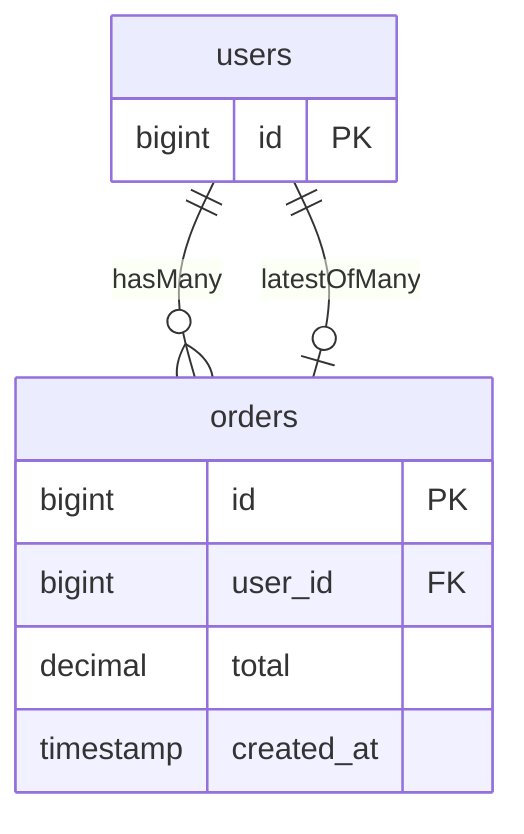

### Model

```php
class User extends Model
{
    /**
     * Get all orders of the user.
     */
    public function orders(): HasMany
    {
        return $this->hasMany(Order::class);
    }

    /**
     * Get the most recent order of the user.
     */
    public function latestOrder(): HasOne
    {
        return $this->orders()->one()->latestOfMany();
    }

    /**
     * Get the oldest order of the user.
     */
    public function oldestOrder(): HasOne
    {
        return $this->hasOne(Order::class)->oldestOfMany();
    }

    /**
     * Get the largest order of the user.
     */
    public function largestOrder(): HasOne
    {
        return $this->hasOne(Order::class)->ofMany('total', 'max');
    }
}
```

### Access

```php
$user->latestOrder;  // Order|null — one row, not a collection
User::with('latestOrder')->get(); // eager loads without N+1
```

---

## 10. Polymorphic One To One — `morphOne` / `morphTo`

**Use when:** one child model can belong to **different parent types**, one child per parent. Example: an image for a user or for a post.

### Table diagram

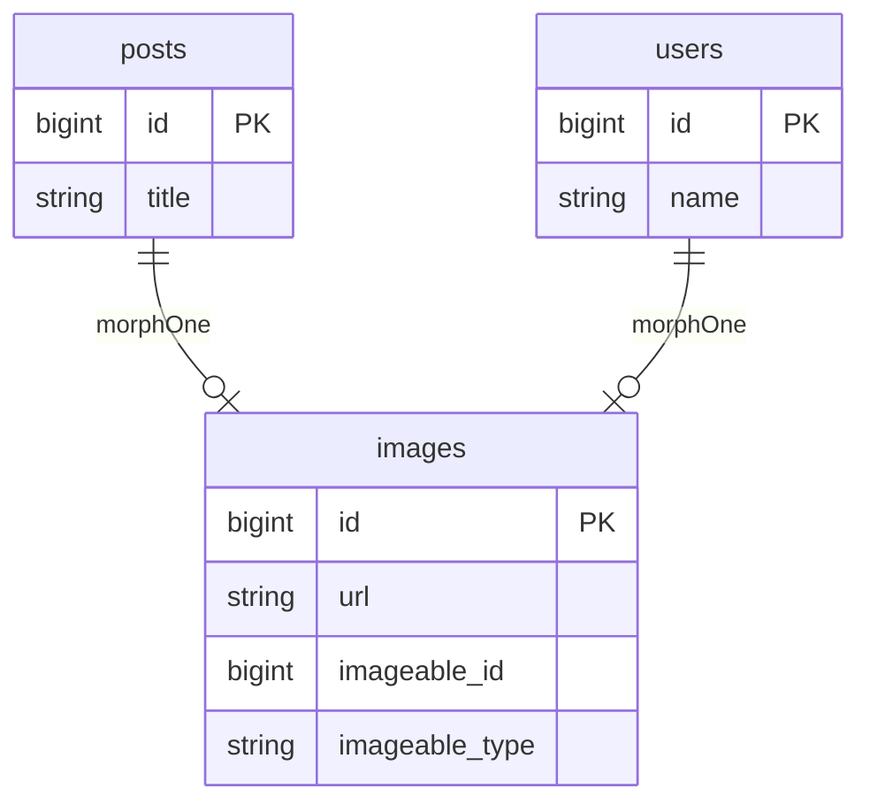

### Sample data

| images.id | url | imageable_id | imageable_type |
|-----------|-----|--------------|----------------|
| 1 | a.jpg | 5 | post |
| 2 | b.jpg | 5 | user |

`imageable_type` tells Eloquent *which table* `imageable_id` points to.

### Migration

```php
Schema::create('images', function (Blueprint $table) {
    $table->id();
    $table->string('url');
    $table->morphs('imageable'); // imageable_id (bigint) + imageable_type (string) + index
    $table->timestamps();
});
```

### Models

```php
class Post extends Model
{
    /**
     * Get the post's image.
     */
    public function image(): MorphOne
    {
        return $this->morphOne(Image::class, 'imageable');
    }
}

class Image extends Model
{
    /**
     * Get the parent imageable model (user or post).
     */
    public function imageable(): MorphTo
    {
        return $this->morphTo();
    }
}
```

### Access

```php
$post->image;          // Image|null
$image->imageable;     // Post or User instance
```

### Implemented in this repository

- Official docs: [One To One (Polymorphic)](https://laravel.com/docs/eloquent-relationships#one-to-one-polymorphic-relations)
- Controllers: [`ImageableController`](app/Http/Controllers/Image/ImageableController.php) and [`ImageController`](app/Http/Controllers/Image/ImageController.php)
- Actions: [`app/Actions/Image`](app/Actions/Image)
- Seeder: [`ImageSeeder`](database/seeders/ImageSeeder.php)
- Base URL: `/api/polymorphic-one-to-one`
- Morph map: `user`, `post`, `video` in [`AppServiceProvider`](app/Providers/AppServiceProvider.php), so `imageable_type` stores `user` and not `App\Models\User`

One action serves both parent types. `{type}` in the URL is a morph map alias (`user` or `post`) and [`ResolveImageable`](app/Actions/Image/ResolveImageable.php) turns it into the model.

**Parent side: `User::image()` and `Post::image()` (`morphOne`)**

| Method | URL | Action | Eloquent |
|--------|-----|--------|----------|
| `GET` | `/{type}?has_image=0` | [`ListImageables`](app/Actions/Image/ListImageables.php) | `with('image')`, `has()`, `doesntHave()` |
| `GET` | `/{type}/{id}/image` | [`ShowImageableImage`](app/Actions/Image/ShowImageableImage.php) | `$model->image` |
| `GET` | `/{type}/{id}/image/exists` | [`CheckImageableHasImage`](app/Actions/Image/CheckImageableHasImage.php) | `image()->exists()` |
| `POST` | `/{type}/{id}/image` | [`CreateImageableImage`](app/Actions/Image/CreateImageableImage.php) | `image()->create()` |
| `PUT` | `/{type}/{id}/image` | [`UpdateOrCreateImageableImage`](app/Actions/Image/UpdateOrCreateImageableImage.php) | `image()->updateOrCreate([], $data)` |
| `PATCH` | `/{type}/{id}/image` | [`UpdateImageableImage`](app/Actions/Image/UpdateImageableImage.php) | `$model->image->update()` |
| `DELETE` | `/{type}/{id}/image` | [`DeleteImageableImage`](app/Actions/Image/DeleteImageableImage.php) | `$model->image->delete()` |

**Child side: `Image::imageable()` (`morphTo`)**

| Method | URL | Action | Eloquent |
|--------|-----|--------|----------|
| `GET` | `/images?type=user` | [`ListImagesWithImageable`](app/Actions/Image/ListImagesWithImageable.php) | `with('imageable')`, `where('imageable_type', ...)` |
| `GET` | `/images/details` | [`ListImagesWithImageableDetails`](app/Actions/Image/ListImagesWithImageableDetails.php) | `morphWith()` |
| `GET` | `/images/search?term=Karim` | [`SearchImagesByImageableName`](app/Actions/Image/SearchImagesByImageableName.php) | `whereHasMorph()` |
| `GET` | `/images/{image}/imageable` | [`ShowImageable`](app/Actions/Image/ShowImageable.php) | `$image->imageable` |
| `PUT` | `/images/{image}/imageable` | [`ReassignImage`](app/Actions/Image/ReassignImage.php) | `imageable()->associate()` |
| `DELETE` | `/images/{image}` | [`DeleteImage`](app/Actions/Image/DeleteImage.php) | `delete()` |

The `images` table has a unique index on `(imageable_type, imageable_id)`, so a parent can own only one image. Create returns `409` when the parent already has one. Seed data: images for users 1 to 3 and posts 1 to 3.

---

## 11. Polymorphic One To Many — `morphMany` / `morphTo`

**Use when:** many children belong to **different parent types**. Example: comments on posts and on videos.

### Table diagram

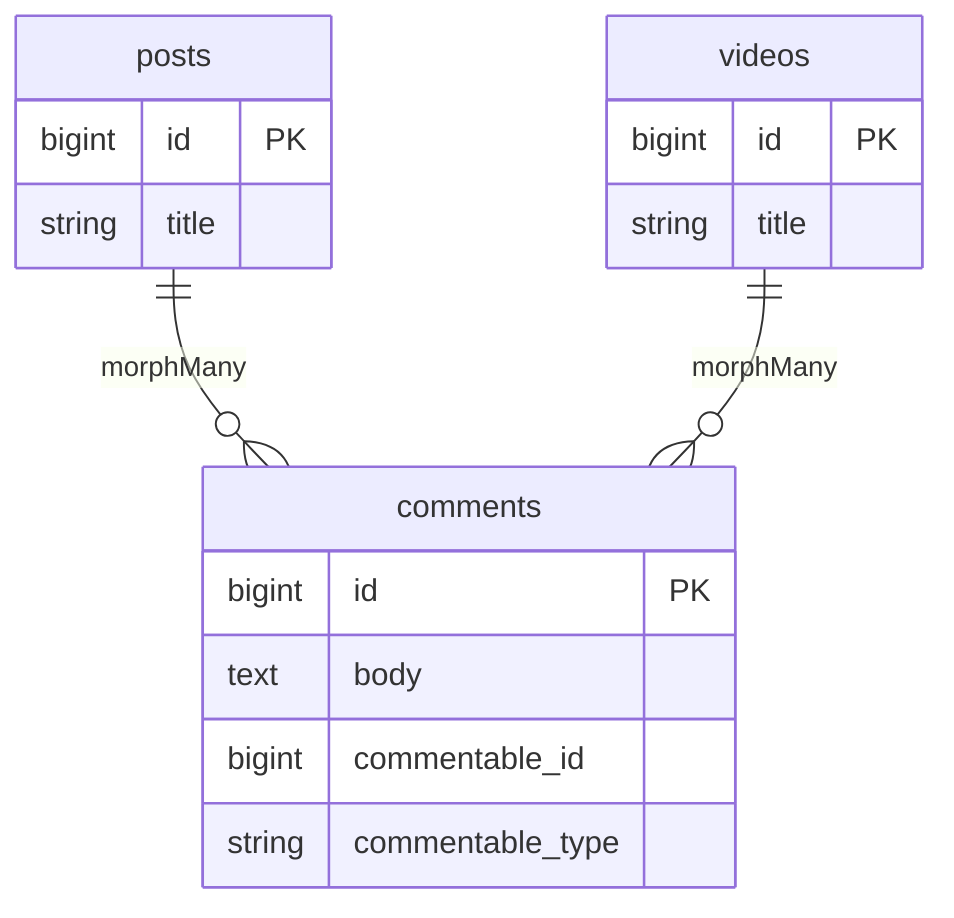

### Sample data

| comments.id | body | commentable_id | commentable_type |
|-------------|------|----------------|------------------|
| 1 | Great | 1 | post |
| 2 | Cool | 1 | video |
| 3 | Thanks | 1 | post |

### Migration

```php
Schema::create('comments', function (Blueprint $table) {
    $table->id();
    $table->text('body');
    $table->morphs('commentable');
    $table->timestamps();
});
```

### Models

```php
class Post extends Model
{
    /**
     * Get all comments of the post.
     */
    public function comments(): MorphMany
    {
        return $this->morphMany(Comment::class, 'commentable');
    }
}

class Video extends Model
{
    /**
     * Get all comments of the video.
     */
    public function comments(): MorphMany
    {
        return $this->morphMany(Comment::class, 'commentable');
    }
}

class Comment extends Model
{
    /**
     * Get the parent commentable model (post or video).
     */
    public function commentable(): MorphTo
    {
        return $this->morphTo();
    }
}
```

### Access

```php
$post->comments;
$comment->commentable;                    // Post or Video
$post->comments()->create(['body' => 'Hi']); // sets both columns for you
```

### Use a morph map (recommended)

Without a map, the full class name is stored in `*_type`. A rename or namespace move then breaks old rows. Register aliases once:

```php
use Illuminate\Database\Eloquent\Relations\Relation;

/**
 * Bootstrap any application services.
 */
public function boot(): void
{
    Relation::enforceMorphMap([
        'post' => Post::class,
        'video' => Video::class,
    ]);
}
```

---

## 12. Polymorphic Many To Many — `morphToMany` / `morphedByMany`

**Use when:** many-to-many, and the "many" side spans several model types. Example: one `tags` table shared by posts and videos.

### Table diagram

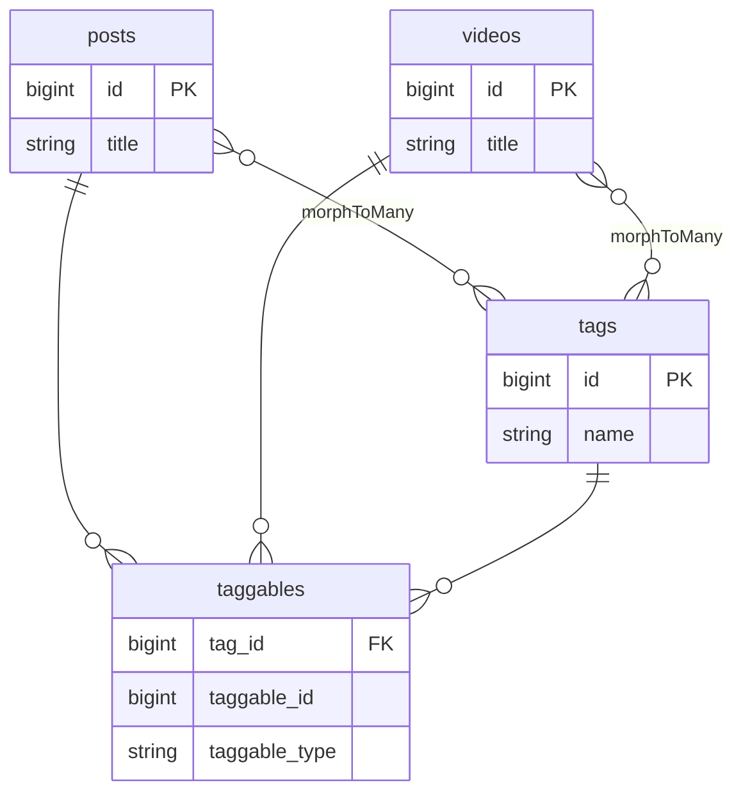

### Sample data

| taggables.tag_id | taggable_id | taggable_type |
|------------------|-------------|---------------|
| 1 | 1 | post |
| 1 | 1 | video |
| 2 | 1 | post |

### Migration

```php
Schema::create('taggables', function (Blueprint $table) {
    $table->foreignId('tag_id')->constrained()->cascadeOnDelete();
    $table->morphs('taggable');
    $table->unique(['tag_id', 'taggable_id', 'taggable_type']);
});
```

### Models

```php
class Post extends Model
{
    /**
     * Get all tags of the post.
     */
    public function tags(): MorphToMany
    {
        return $this->morphToMany(Tag::class, 'taggable');
    }
}

class Tag extends Model
{
    /**
     * Get all posts that have this tag.
     */
    public function posts(): MorphToMany
    {
        return $this->morphedByMany(Post::class, 'taggable');
    }

    /**
     * Get all videos that have this tag.
     */
    public function videos(): MorphToMany
    {
        return $this->morphedByMany(Video::class, 'taggable');
    }
}
```

### Access

```php
$post->tags;          // Collection<Tag>
$tag->posts;          // Collection<Post>
$tag->videos;         // Collection<Video>
$post->tags()->sync([1, 2]);
```

---

## 13. Self-Referencing Relationships

**Use when:** a table relates to itself. Example: categories with parent/child, employees with a manager.

### Table diagram

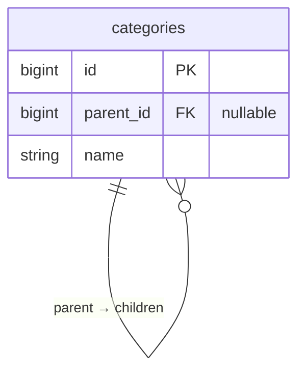

### Sample data

| id | parent_id | name |
|----|-----------|------|
| 1 | NULL | Electronics |
| 2 | 1 | Phones |
| 3 | 1 | Laptops |
| 4 | 2 | Android |

### Migration

```php
Schema::create('categories', function (Blueprint $table) {
    $table->id();
    $table->foreignId('parent_id')->nullable()->constrained('categories')->nullOnDelete();
    $table->string('name');
    $table->timestamps();
});
```

### Model

```php
class Category extends Model
{
    /**
     * Get the parent category.
     */
    public function parent(): BelongsTo
    {
        return $this->belongsTo(Category::class, 'parent_id');
    }

    /**
     * Get the direct child categories.
     */
    public function children(): HasMany
    {
        return $this->hasMany(Category::class, 'parent_id');
    }

    /**
     * Get all descendants recursively.
     */
    public function descendants(): HasMany
    {
        return $this->children()->with('descendants');
    }
}
```

### Access

```php
$category->parent;
$category->children;
Category::whereNull('parent_id')->with('descendants')->get(); // full tree
```

---

## 14. Default Models — `withDefault`

`belongsTo`, `hasOne`, `hasOneThrough`, and `morphOne` return `null` when nothing is related. Return an empty model instead to avoid `null` checks in views.

```php
/**
 * Get the author of the post.
 */
public function author(): BelongsTo
{
    return $this->belongsTo(User::class)->withDefault([
        'name' => 'Guest Author',
    ]);
}

$post->author->name; // "Guest Author" when user_id is NULL
```

---

## 15. Accessing Relationships

| Syntax | Returns | Runs query? | Use for |
|--------|---------|-------------|---------|
| `$post->comments` | Collection (cached on the model) | Once, then cached | Reading related data |
| `$post->comments()` | Relation / query builder | Not until you call `get()` etc. | Adding constraints, `create`, `count` |
| `$post->comments()->where(...)->get()` | Collection | Yes, every time | Filtered related data |
| `$post->load('comments')` | The model | Yes, if not loaded | Eager load after the fact |
| `$post->loadMissing('comments')` | The model | Only if not loaded | Safe repeated eager load |

```php
$post->comments;                                   // dynamic property
$post->comments()->where('approved', true)->get(); // method call
```

---

## 16. Writing Through Relationships

### `hasOne` / `hasMany` / `morphMany`

```php
$post->comments()->create(['body' => 'New']);               // insert one
$post->comments()->createMany([['body' => 'A'], ['body' => 'B']]);
$post->comments()->save(new Comment(['body' => 'C']));      // save an instance
```

### `belongsTo`

```php
$comment->post()->associate($post); // sets post_id in memory
$comment->save();

$comment->post()->dissociate();     // sets post_id to null
$comment->save();
```

### `belongsToMany` / `morphToMany`

```php
$user->roles()->attach(1);
$user->roles()->sync([1, 2]);
$user->roles()->detach();
```

### Touching parent timestamps

Update the parent's `updated_at` whenever a child changes:

```php
class Comment extends Model
{
    protected $touches = ['post'];
}
```

---

## 17. Querying Relationships

| Goal | Method | Example |
|------|--------|---------|
| Has at least one | `has` | `Post::has('comments')->get()` |
| Has at least N | `has` | `Post::has('comments', '>=', 3)->get()` |
| Has one matching a condition | `whereHas` | `Post::whereHas('comments', fn ($q) => $q->where('approved', true))->get()` |
| Has none | `doesntHave` | `Post::doesntHave('comments')->get()` |
| Has none matching a condition | `whereDoesntHave` | `Post::whereDoesntHave('comments', fn ($q) => $q->where('spam', true))->get()` |
| Filter and eager load together | `withWhereHas` | `Post::withWhereHas('comments', fn ($q) => $q->where('approved', true))->get()` |
| Count related | `withCount` | `Post::withCount('comments')->get()` → `$post->comments_count` |
| Sum / Avg / Min / Max | `withSum` etc. | `Order::withSum('items', 'price')->get()` → `$order->items_sum_price` |
| Existence flag | `withExists` | `Post::withExists('comments')->get()` → `$post->comments_exists` |
| Polymorphic filter | `whereHasMorph` | `Comment::whereHasMorph('commentable', [Post::class, Video::class], fn ($q) => $q->where('title', 'like', 'A%'))->get()` |

---

## 18. Eager Loading and the N+1 Problem

### The problem

```php
$posts = Post::all();            // 1 query

foreach ($posts as $post) {
    echo $post->author->name;    // +1 query per post → 101 queries for 100 posts
}
```

### The fix

```php
$posts = Post::with('author')->get(); // 2 queries total
```

### Patterns

```php
Post::with(['author', 'comments'])->get();                 // several relations
Post::with('comments.user')->get();                        // nested relation
Post::with(['comments' => fn ($q) => $q->latest()->limit(5)])->get(); // constrained
Post::with('author:id,name')->get();                       // select only some columns
```

> When selecting columns, always include the foreign and primary keys (`id` and `author_id`) or the relation will come back empty.

### Fail loudly in development

Add this to `AppServiceProvider::boot()` so a lazy load throws instead of silently slowing the app:

```php
use Illuminate\Database\Eloquent\Model;

/**
 * Bootstrap any application services.
 */
public function boot(): void
{
    Model::preventLazyLoading(! $this->app->isProduction());
}
```

### Avoid the extra query for the inverse side (Laravel 11.x+)

```php
/**
 * Get the comments for the post.
 */
public function comments(): HasMany
{
    return $this->hasMany(Comment::class)->chaperone('post');
}

$post->comments->first()->post; // no extra query, parent is reused
```

---

## 19. Best Practices

- **Always type-hint the return type** (`HasMany`, `BelongsTo`, …). It documents intent and helps static analysis.
- **Add foreign key constraints** in migrations with `foreignId()->constrained()` and choose a delete rule (`cascadeOnDelete`, `nullOnDelete`).
- **Index every foreign key.** `foreignId()` and `morphs()` already do this.
- **Eager load** in controllers and queries. Enable `preventLazyLoading` outside production.
- **Use `enforceMorphMap`** for every polymorphic relation so `*_type` never stores class names.
- **Use `exists()` / `count()`** on the relation method instead of loading a full collection to check.
- **Keep relationship methods thin.** Put business filters in query scopes and name them clearly.
- **Pick the right type:** if only one related row matters, use `latestOfMany` instead of `$post->comments->first()`.
- **Mark mass-assignable fields** with `$fillable` before using `create()` through a relation.

---

## 20. Common Mistakes

| Mistake | Why it hurts | Fix |
|---------|--------------|-----|
| Loop calling `$model->relation` without eager loading | N+1 queries | `Model::with('relation')` |
| `$post->comments->where(...)` on a big relation | Loads everything, filters in PHP | `$post->comments()->where(...)->get()` |
| Putting the FK on the wrong table | Relation returns `null` or wrong rows | FK goes on the `belongsTo` side |
| Pivot table named `users_roles` | Eloquent expects `role_user` | Alphabetical, singular, or pass the table name |
| Forgetting `withPivot()` | Extra pivot columns are missing | Declare each extra column |
| Using `sync()` when you only want to add | Removes every other row | Use `syncWithoutDetaching()` |
| Polymorphic without a morph map | Class names stored in the database | `Relation::enforceMorphMap()` |
| `select('name')` while eager loading | Relation is empty | Include the key columns |
| Forgetting `->save()` after `associate()` | Nothing is written | Call `save()` |

---

## 21. License

Released under the [MIT License](LICENSE).